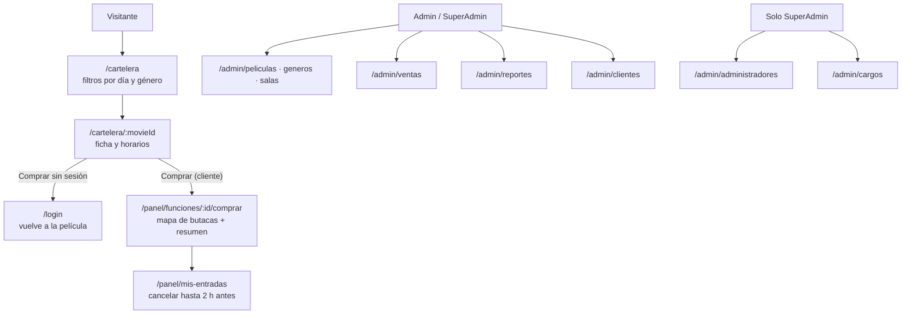

# CinemAPIFront

Front web del sistema de gestión de cines: cartelera pública, compra de entradas con mapa de butacas, área del cliente y panel del staff. React 19 + Vite, JavaScript, react-bootstrap. Consume la API del repo `CinemAPI` (la guía para la defensa está en `CinemAPI/docs/defensa.md`).

## Requisitos y arranque

- Node.js 20 o superior.
- La API corriendo en `http://localhost:5288` (ver el README de `CinemAPI`). La URL se configura en `.env.development` (`VITE_API_URL`).

```bash
npm install
npm run dev        # http://localhost:5173
```

Usuarios demo (solo con la API en Development): `admin@cinemapi.com` y `cliente@cinemapi.com`, con la contraseña configurada en `DemoUsers:Password`; el SuperAdmin es el de `SeedSuperAdmin:*`. Cualquiera puede registrarse como cliente desde `/registro`.

## Pantallas por rol



| Layout | Para quién | Cómo es |
|---|---|---|
| `PublicLayout` | Cartelera y cliente (`/cartelera`, `/panel/*`) | Barra superior (Navbar de react-bootstrap) que se colapsa en celular |
| `AppLayout` | Staff (`/admin/*`) | Barra lateral; en celular pasa arriba |

`ProtectedRoute` decide por rol; sin sesión manda al login recordando a dónde se quería ir. El front solo esconde: quien autoriza de verdad es la API.

## Estructura

```
src/
  api/          Única capa que habla con el backend (request() agrega el token y traduce ProblemDetails)
  auth/         Login, Register, ProtectedRoute, session, roles
  components/
    common/     EntityForm, EntityCard, EntityGrid, FieldInput, LoadState, RouteErrorBoundary
    Billboard/  Cartelera pública (afiches, filtros, horarios)
    Purchases/  Mapa de butacas, resumen, compras y filtros de ventas
    Reports/    Rango de fechas, tarjetas de totales y tablas
    Fees/ Genres/ Movies/ Screens/ Users/   ABM de cada entidad
    Layout/     PublicLayout, AppLayout, Sidebar, LazyOutlet
  hooks/        useEntityCrud, useAsyncData, useSeatSelection, usePurchaseList, useSession…
  pages/        Pantallas compuestas (BillboardPage, MovieDetailPage, PurchasePage, MyPurchases, SalesPage, ReportsPage, Profile)
  utils/        Fechas, dinero y butacas (sin estado)
```

Decisiones principales (detalle en `CLAUDE.md`):

- **Genéricos para los ABM.** Géneros, salas, cargos, clientes y administradores son una configuración de campos sobre `EntityForm` + `EntityCard` + `EntityGrid` + `useEntityCrud`, no componentes copiados.
- **La API está aislada.** Los componentes nunca llaman a `fetch`; la forma del JSON se adapta solo en `src/api/`.
- **Los importes los decide el backend.** El resumen de compra calcula subtotal + cargo igual que la API para mostrarlo antes de confirmar, pero el total que vale es el que devuelve la compra.
- **Carga liviana.** Las pantallas que no son públicas se cargan con `React.lazy`, así la cartelera abre con ~300 kB de JS.
- **Sin estilos inline.** Todo está en `index.css` (variables en `:root`) o en utilidades de Bootstrap.

## Scripts

| Comando | Qué hace |
|---|---|
| `npm run dev` | Servidor de desarrollo |
| `npm run lint` | ESLint (reglas de hooks y de React Refresh) |
| `npm run build` | Build de producción en `dist/` |

`CinemapiPhone/` es una app móvil Expo separada, con sus propias reglas: el lint de este proyecto la ignora.
